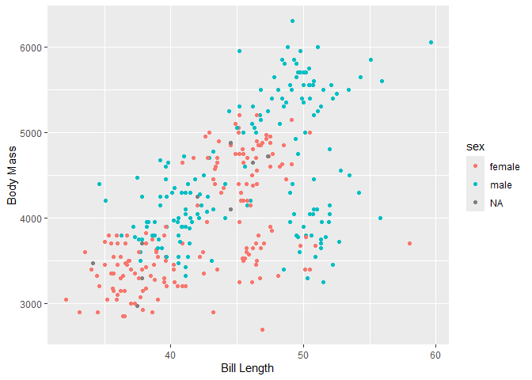

analysis.R
================
msant
2026-10-16

First, I am going to go ahead and install the necessary package and load
the dataset.

``` r
# This is the palmerpenguins package that has the dataset 'penguins'
# ggplot2 is for the graphing; pretty confident it's already installed
install.packages("palmerpenguins")
```

    ## Warning: package 'palmerpenguins' is in use and will not be installed

``` r
library(palmerpenguins)
library(ggplot2)
```

Let’s take a look at what exactly is in the dataset here

``` r
head(penguins)
```

    ## # A tibble: 6 × 8
    ##   species island    bill_length_mm bill_depth_mm flipper_length_mm body_mass_g sex     year
    ##   <fct>   <fct>              <dbl>         <dbl>             <int>       <int> <fct>  <int>
    ## 1 Adelie  Torgersen           39.1          18.7               181        3750 male    2007
    ## 2 Adelie  Torgersen           39.5          17.4               186        3800 female  2007
    ## 3 Adelie  Torgersen           40.3          18                 195        3250 female  2007
    ## 4 Adelie  Torgersen           NA            NA                  NA          NA <NA>    2007
    ## 5 Adelie  Torgersen           36.7          19.3               193        3450 female  2007
    ## 6 Adelie  Torgersen           39.3          20.6               190        3650 male    2007

``` r
summary(penguins)
```

    ##       species          island    bill_length_mm  bill_depth_mm   flipper_length_mm  body_mass_g       sex     
    ##  Adelie   :152   Biscoe   :168   Min.   :32.10   Min.   :13.10   Min.   :172.0     Min.   :2700   female:165  
    ##  Chinstrap: 68   Dream    :124   1st Qu.:39.23   1st Qu.:15.60   1st Qu.:190.0     1st Qu.:3550   male  :168  
    ##  Gentoo   :124   Torgersen: 52   Median :44.45   Median :17.30   Median :197.0     Median :4050   NAs   : 11  
    ##                                  Mean   :43.92   Mean   :17.15   Mean   :200.9     Mean   :4202               
    ##                                  3rd Qu.:48.50   3rd Qu.:18.70   3rd Qu.:213.0     3rd Qu.:4750               
    ##                                  Max.   :59.60   Max.   :21.50   Max.   :231.0     Max.   :6300               
    ##                                  NAs    :2       NAs    :2       NAs    :2         NAs    :2                  
    ##       year     
    ##  Min.   :2007  
    ##  1st Qu.:2007  
    ##  Median :2008  
    ##  Mean   :2008  
    ##  3rd Qu.:2009  
    ##  Max.   :2009  
    ## 

Time to create a plot of it

``` r
# simple scatter plot showing bill length vs body math separated by male and female penguins
ggplot(penguins, aes(x=bill_length_mm, y=body_mass_g, color=sex)) +
  geom_point() +
  labs(x="Bill Length", y="Body Mass")
```

    ## Warning: Removed 2 rows containing missing values or values outside the scale range (`geom_point()`).

<!-- -->
